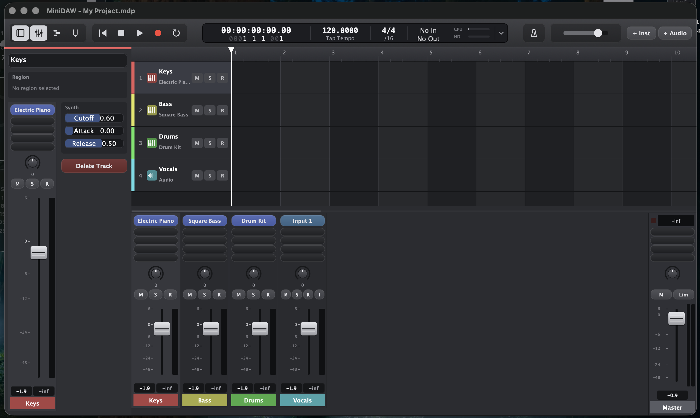
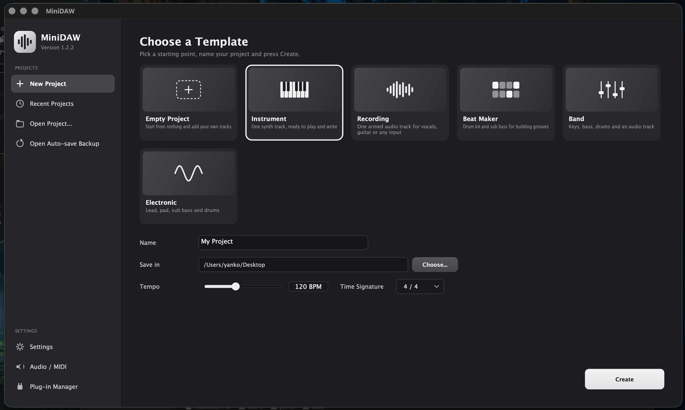
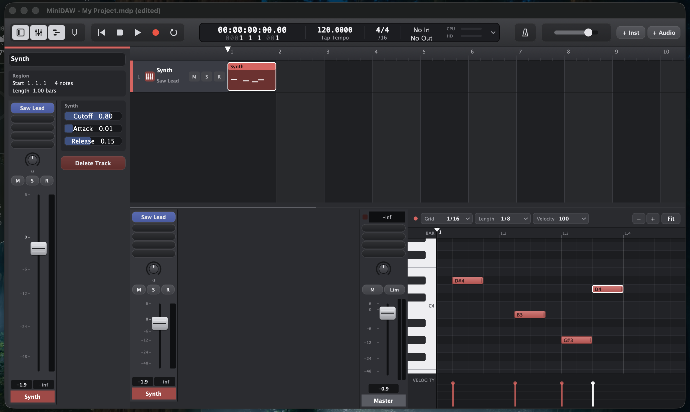
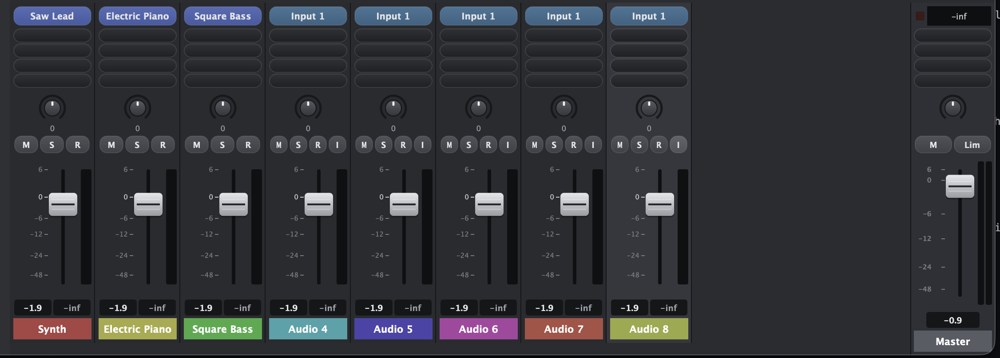
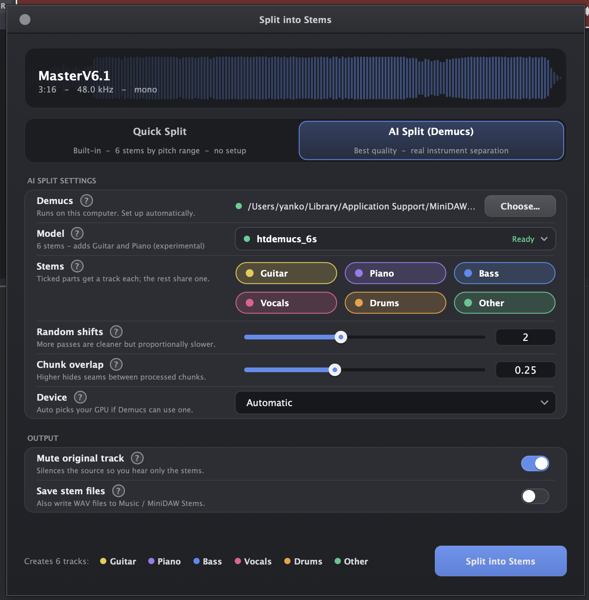
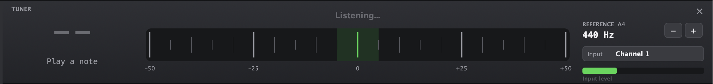

# MiniDAW

[](https://opensource.org/licenses/MIT)
[](https://en.cppreference.com/w/cpp/17)
[](https://juce.com/)
[](https://cmake.org/)
[]()
[](https://github.com/kysyonchev/MiniDAW)

A small, Logic-inspired digital audio workstation built on [JUCE](https://juce.com/). It has an arrangement timeline, a piano roll, a mixer, instrument and audio tracks, VST3/AU hosting, a metronome, a tuner, and a stem splitter — either a built-in FFT engine or [Demucs](https://github.com/facebookresearch/demucs) running on your machine.



---

## Contents

- [Features](#features)
- [Screenshots](#screenshots)
- [Building](#building)
- [Running the tests](#running-the-tests)
- [Keyboard shortcuts](#keyboard-shortcuts)
- [Project files](#project-files)
- [Split into Stems](#split-into-stems)
- [Project structure](#project-structure)
- [Status and limitations](#status-and-limitations)
- [License](#license)
- [Acknowledgements](#acknowledgements)

---

## Features

### Timeline and editing
- Bar / beat arrangement view with a ruler, per-track lanes and colour-coded regions.
- Instrument and audio tracks, M / S / R buttons per lane, per-track colour palette.
- Region drag, delete, duplicate, and snap to bar / beat / half beat / off.
- Undo / redo (up to 100 steps) for region edits, plus **Split at playhead**, **Quantize**, **Transpose** and **Set / humanize velocity** from the Edit menu.

### Piano roll
- Click to add a note, drag to move, drag the right edge to resize, right-click to delete.
- Grid from off up to 1/32, default note length, default velocity.
- Velocity lane at the bottom, per-note velocity editing.
- Cmd+wheel to zoom time, Alt+wheel to zoom pitch, wheel to scroll.
- Keyboard preview: clicking a key or a note auditions it on the selected track's instrument (including external plugins).

### Instruments and effects
- Built-in polyphonic synth with 10 presets (Saw Lead, Square Bass, Sine Pad, Triangle Keys, Warm Saw, Electric Piano, Organ, Sub Bass, Strings, Drum Kit) and a low-pass filter per track.
- Synthesized drum kit (kick, snare, clap, hats, toms) triggered from the piano roll.
- VST3 and AU plugin hosting, one instrument per track and up to four insert effects after it.
- Plugin manager with a background scanner, search, and a per-format list.

### Mixer
- Logic-style channel strip per track: pan, fader, level meter with peak hold, M / S / R / I buttons, plugin slots.
- Master channel with its own inserts, balance, fader, mute, soft limiter and stereo meters.
- Track level meters and master peak hold use the same dB scale as the faders.

### Audio recording
- Lock-free recording on the audio thread — never writes past its buffer.
- Takes are trimmed to length and aligned using the device's reported latency (or a manual value if the driver lies).
- Live input level meter, monitoring toggle, and a growing "Recording..." region while you play.
- Audio buffer grows automatically mid-take if a recording runs longer than the initial 2 minutes.

### Metronome and transport
- Four click sounds (beep, wood block, hi-hat tick, cowbell), adjustable volume, accent on the first beat, subdivisions, count-in.
- Time signatures 2/4 through 12/4.
- Tap tempo, tempo drag on the display, numeric tempo entry.
- Cycle / loop range, click-only-while-recording mode.
- Chromatic tuner listening to a selectable input channel, with reference pitch adjustable in 1 Hz steps.

### Files
- Project files (`.mdp`) are gzip containers with the XML project plus embedded audio takes; older plain-XML projects still open.
- Autosave backup every 1 / 2 / 5 / 10 minutes (optional), reopenable from the start screen or File menu.
- Recent projects list with search, file size and modification date.
- New project templates: Empty, Instrument, Recording, Beat Maker, Band, Electronic.

### Import and export
- Drag audio files (WAV, AIFF, FLAC, MP3, M4A, OGG) from Finder / Explorer onto the arrangement — they land where you drop them, snapped to a quarter beat, on an existing audio track or a new one.
- Import any supported format as a region with a single shortcut.
- Bounce the full project to **WAV (16 / 24 / 32-bit float)**, **AIFF (16 / 24-bit)** or **FLAC (16 / 24-bit)**, or export just the last recorded take.
- Optional normalisation to −1 dBFS on export.

### Stems
- Built-in Quick Split (harmonic / percussive + pitch zones, no external tools) or AI Split via Demucs.
- Ticked stems each become their own track, everything else is mixed into a single "Rest" track, so the stems always add back up to the original.
- Demucs can be set up and its models downloaded from inside the app — no terminal required.

---

## Screenshots

### Start screen


### Piano roll


### Mixer


> **Image to add — `docs/images/mixer.png`:** The mixer strip row with a few tracks, one with an instrument plugin and one or two inserts, and the master channel visible on the right.

### Split into Stems


### Tuner


---

## Building

### Requirements

- **CMake 3.22 or newer**
- **A C++17 compiler**
  - macOS: Xcode Command Line Tools (`xcode-select --install`)
  - Windows: Visual Studio 2019 or 2022, with the "Desktop development with C++" workload installed
  - Linux: GCC 9+ or Clang 10+
- **JUCE 8.0.4** — fetched automatically by CMake at configure time, no manual install needed
- On Linux only, the usual JUCE system dependencies:

```bash
sudo apt install libasound2-dev libfreetype6-dev libx11-dev libxrandr-dev \
    libxinerama-dev libxcursor-dev libcurl4-openssl-dev libwebkit2gtk-4.1-dev
```

### Clone the repository

```bash
git clone https://github.com/kysyonchev/MiniDAW.git
cd MiniDAW
```

The first CMake configure downloads JUCE from GitHub, which takes a few minutes. Subsequent builds are incremental.

### Build commands per OS

#### macOS

```bash
cmake -B build -DCMAKE_BUILD_TYPE=Release
cmake --build build --config Release -j
```

The app is built into `build/MiniDAW_artefacts/Release/MiniDAW.app`.

On first launch, macOS will ask for microphone access if you record audio. If you don't see the prompt, allow MiniDAW in System Settings → Privacy & Security → Microphone.

#### Windows

Open a Developer Command Prompt for VS 2022 (or run from a terminal where `cmake` and MSVC are on the PATH) and run:

```bat
cmake -B build -G "Visual Studio 17 2022" -A x64
cmake --build build --config Release
```

The executable is built into `build\MiniDAW_artefacts\Release\MiniDAW.exe`.

If you have an older Visual Studio, swap the generator for `"Visual Studio 16 2019"`. To build a 32-bit binary, replace `-A x64` with `-A Win32`.

Running the built `.exe` directly from the Release folder works; there's no installer. Copy the whole `MiniDAW_artefacts\Release` folder if you want to move it somewhere else — the binary doesn't depend on anything outside it.

#### Linux

```bash
cmake -B build -DCMAKE_BUILD_TYPE=Release
cmake --build build --config Release -j
```

The executable is built into `build/MiniDAW_artefacts/Release/MiniDAW`.

On some distros the CMake configure step needs `-DCMAKE_CXX_COMPILER=g++-11` (or a newer GCC) if the default `g++` is too old for C++17.

---

## Running the tests

The timing math, pitch detection, metronome helpers and the whole stem-split engine are plain C++ with no JUCE dependency. They're covered by unit tests that build on their own:

```bash
cmake -B build -DMINIDAW_BUILD_TESTS=ON
cmake --build build --target test_core
./build/test_core
```

A passing run ends with:

```text
ALL TESTS PASSED (record 48000 samples, 94 peak blocks, sample-accurate playback, normalise, snap/pan/limiter/bars/tap-tempo/tuner/stem-split/6-way zones)
```

The tests cover:

- Recording in odd-sized blocks and buffer-full safety
- Incremental vs one-shot peak generation
- Sample-accurate playback with tempo and start-beat offset
- Normalisation, snapping, pan law, soft limiter
- Bars / beats including negative beats (count-in)
- Tap tempo and meter helpers
- Tuner note math and YIN pitch detection (sine, harmonic-rich tones, silence, noise, below noise floor)
- Quick Split (3-stem and 6-stem zones mode) and stem cancellation

---

## Keyboard shortcuts

| Shortcut | Action |
| --- | --- |
| Space | Play / stop |
| R | Record |
| K | Metronome on / off |
| C | Cycle (loop) on / off |
| T | Tap tempo |
| X | Toggle mixer |
| I | Toggle inspector |
| P | Toggle piano roll |
| U | Toggle tuner |
| + / - | Zoom timeline |
| Return | Go to start |
| D | Duplicate selected region |
| Q | Quantize selected region to 1/16 |
| Delete | Delete selected region |
| Cmd/Ctrl+Z | Undo |
| Shift+Cmd/Ctrl+Z | Redo |
| Cmd/Ctrl+T | Split region at playhead |
| Cmd/Ctrl+N | New project |
| Cmd/Ctrl+O | Open project |
| Cmd/Ctrl+S | Save |
| Shift+Cmd/Ctrl+S | Save As |
| Cmd/Ctrl+W | Close project |
| Cmd/Ctrl+I | Import audio file |
| Cmd/Ctrl+E | Export / bounce |
| Cmd/Ctrl+Delete | Delete track |
| Cmd/Ctrl+, | Preferences |

### Piano roll

| Shortcut | Action |
| --- | --- |
| Click empty space | Add a note (drag to set its length) |
| Drag a note | Move |
| Drag the right edge | Resize |
| Right-click / Alt-click a note | Delete |
| Delete / Backspace | Delete selected note |
| Arrow keys | Nudge (Left/Right) or transpose (Up/Down) |
| Shift + Up/Down | Transpose by an octave |
| Cmd + wheel | Zoom time |
| Alt + wheel | Zoom pitch |
| Wheel | Scroll |

---

## Project files

A `.mdp` file is a gzip-compressed container with:

- a `MINIDAW-PROJECT-2` header
- the project XML (tracks, notes, mixer state, plugin state, master settings)
- each unique audio take stored once as raw float data

Regions that reference the same take share the same blob, so a clip duplicated several times doesn't cost extra disk. The reader is backward-compatible: if the file starts with `<` it is treated as an older plain-XML project and opened directly.

---

## Split into Stems

Two engines, both starting from the same idea: ticked stems each become a new track, unticked stems are summed into one extra "Rest" track.

### Quick Split (built-in)

Runs entirely in-process, no external tools, no downloads.

- Uses a harmonic / percussive median filter over an STFT to separate drum hits from sustained sound, then splits the sustained part into pitch zones with smooth crossovers.
- Two output layouts:
  - Classic: Drums / Bass / Melody
  - Zones: Drums / Bass / Guitar / Piano / Vocals / Other
- Every control has a "?" button explaining what it does in plain language.

It's fast and honest about what it is: a guitar and a piano playing in the same register will end up in the same stem.

### AI Split (Demucs)

Runs Demucs as a command-line tool on your machine.

- If Demucs isn't already installed, the Download button sets it up in a private Python environment under your user app data directory, then fetches the selected model into the normal Demucs cache. Nothing touches your system Python.
- Supported models: `htdemucs`, `htdemucs_ft`, `htdemucs_6s` (adds Guitar and Piano), `mdx_extra`, `hdemucs_mmi`, `mdx_extra_q`.
- Options for random shifts (more passes, cleaner output, slower), chunk overlap, and device (CPU / Apple GPU / NVIDIA CUDA).
- If the automatic install fails, the "?" next to Demucs shows manual install commands for macOS, Windows and Linux with a copy button.

Audio never leaves your machine — Demucs is a local neural network.

---

## Status and limitations

This is a personal project, not a Logic or Reaper replacement. A few things to be aware of:

- Quick Split is an approximation. Drums are pulled out by character (hits vs sustained sound), the rest is sorted by pitch range. Use AI Split for real instrument separation.
- Piano is the weakest stem in Demucs's 6-stem model. That's the model, not the app — it usually sounds smeared.
- Audio regions can't be split at the playhead yet. MIDI regions can.
- The built-in synth is simple. One filter per track, no envelopes beyond attack and release, no modulation.
- No undo for mixer moves. Undo covers region edits (dragging, deleting, splitting, duplicating).
- No time stretching or pitch shifting. Audio regions play at the project tempo at their recorded rate.

---

## License

Released under the MIT License. See [LICENSE](LICENSE) for the full text.

---

## Acknowledgements

- [JUCE](https://juce.com/) — the framework the whole app is built on.
- [Demucs](https://github.com/facebookresearch/demucs) by Meta Research — the AI stem separation model.
